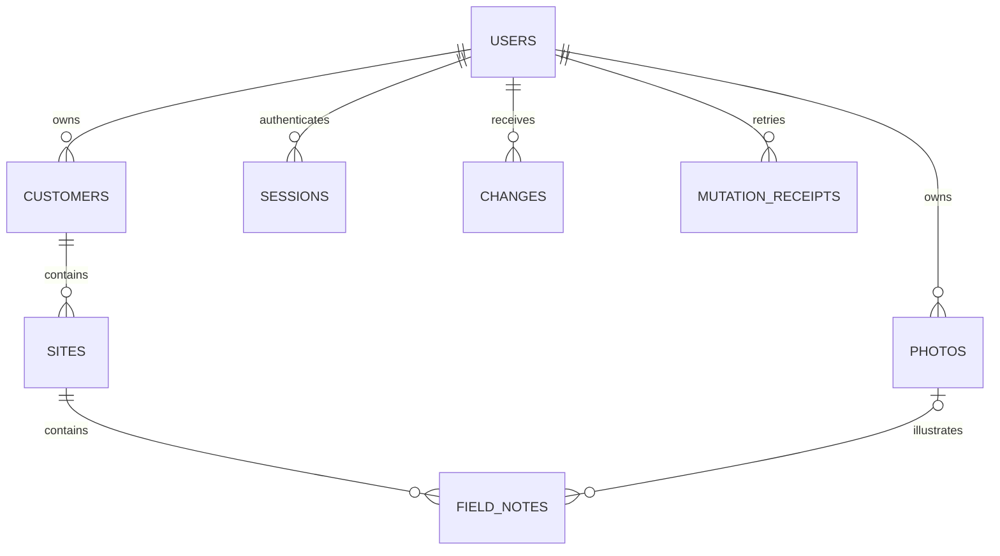

# PostgreSQL database design

## Business relationships

| Table | Purpose and keys |
| --- | --- |
| users | UUID PK; unique normalized email; BCrypt password hash; transactional revision counter |
| sessions | SHA-256 token digest PK; user FK; expiry timestamp |
| customers | UUID PK; owner FK; name/contact; version and tombstone |
| sites | UUID PK; owner FK; composite customer+owner FK; name/address; version and tombstone |
| field_notes | UUID PK; owner FK; composite site+owner and photo+owner FKs; title/description/location/time/status; version and tombstone |
| photos | UUID PK; owner FK; image type/digest/bytes; immutable |
| changes | owner+revision PK; entity type/UUID; immutable JSON snapshot as text |
| mutation_receipts | owner+mutation UUID PK; request digest; original JSON acknowledgment as text |

`owner_id` is deliberate access-control metadata, not a duplicated customer/site attribute. Composite parent/owner constraints prevent assigning a user's site to another user's customer, even if service validation is bypassed. Note views query field_notes JOIN sites JOIN customers; changing a customer/site name appears immediately in reads without updating any note.

UUIDs are globally unique within each business table. Reusing another owner's UUID returns a generic conflict through the database primary key; no foreign data is returned. Active rows are queried with owner_id and deleted=false. Relation validation additionally checks parent tombstones. No database ON DELETE CASCADE is used because offline devices need observable tombstones instead of physical deletion.

Each business row starts at version 1. Every accepted edit/delete increments it. The client compares against its server baseline with expectedVersion. Creation is expectedVersion 0. All writes for an account lock that user's row. This serializes same-account mutations while allowing different users to write concurrently. Receipt and revision records participate in the same transaction as the business changes. The revision uses a transactional counter rather than a global nontransactional sequence, so a reader cannot move past an uncommitted lower revision.

Index strategy: V1 provides owner/relationship indexes and the change-log primary key. V2 adds partial B-tree indexes for active rows on `(owner_id, updated_at DESC, id)`, plus customer/site/status filter prefixes matching list queries. This allows newest-first first-page reads without sorting all owned rows. UUID detail fetches use primary keys; joined display names come from a single query, avoiding per-note lookups. List size is capped at 100; sync pull size at 500. Photos are fetched separately, never as list payloads.

V2 enables `pg_trgm` and adds partial GIN indexes for note title/description, site name, and customer name. Search uses escaped, parameterized ILIKE so `%`, `_`, and `!` remain literal user text. Candidate note IDs are combined with UNION across note/site/customer searches before the outer joined fetch; related names stay normalized. Short or very common searches may still use sequential scans when PostgreSQL estimates they are cheaper. Dynamic table names come exclusively from a fixed enum. These indexes add storage and write maintenance overhead.

The PostgreSQL tests verify a newest-first index plan with no explicit sort and a selective title search using the GIN index on a 6,000-note test-only workload after normal pending-list maintenance. They verify literal escaping and search across all four fields. Query plan verification is not a production latency guarantee: use EXPLAIN (ANALYZE, BUFFERS), realistic data, and load testing for deployment sizing. Very deep OFFSET pages still scan skipped entries; keyset pagination is a future compatible extension for large histories. Run normal autovacuum/ANALYZE maintenance so statistics and GIN indexes remain healthy.

Reference: [PostgreSQL trigram indexing](https://www.postgresql.org/docs/17/pgtrgm.html).

The authoritative schema and indexes are the versioned Flyway migrations; add later numbered migrations instead of editing applied migrations. There is no seed migration. Sync log snapshots duplicate an entity's historical editable values for replay, but never denormalize customer/site names into notes. Photo bytes and historical snapshots share the database backup lifecycle.
